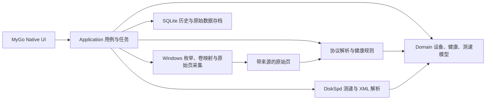

# goDisk — Disk Health & Performance Monitor

Windows 磁盘健康检测与性能测试工具 · 架构草案 · 2026-11-20

## 技术路线

首期面向 Windows 11 x64。使用 Go 实现设备枚举、健康采集与解析、测速编排和持久化。MyGo Native UI 负责窗口、用户输入和状态呈现。Microsoft DiskSpd 作为独立的测速进程。SQLite 保存健康快照、测试结果与采样记录。具体可行性、版本和设备边界见 [技术调研](TECHNICAL_RESEARCH.md)。



- 入口负责装配具体实现。Application 通过少量用例接口拿到设备、健康与测速能力。Domain 只依赖 Go 标准库。
- UI 只调用应用用例，例如 `ListDisks`、`RefreshHealth`、`ExportCapture`、`StartBenchmark`、`CancelBenchmark` 和历史查询。Windows IOCTL、DiskSpd 与 SQLite 分别由各自适配器处理。
- 应用用有界 Go worker、`context.Context` 和不可变快照组织任务。MyGo 通过 `Window.Update` 接收合并后的快照，避免高频 I/O 通知挤占 GUI。窗口关闭时先请求取消并等待应用清理，期间保留状态反馈。

## 目标目录

```text
goDisk/
├── cmd/goDisk/                 # 装配、启动和退出
├── internal/
│   ├── application/           # 设备、健康、测速、历史用例及应用状态
│   ├── domain/                # device、health、benchmark
│   ├── discovery/             # 枚举和卷映射
│   ├── platform/windows/      # SetupAPI、句柄、IOCTL、进程设施
│   ├── protocol/              # NVMe 和 ATA 原始页的纯 Go 解码
│   ├── smart/                 # 厂商识别和健康规则
│   ├── capture/               # 原始数据存档、脱敏和回放
│   ├── benchmark/             # DiskSpd 适配器、XML、任务状态
│   ├── monitor/               # 测试阶段的温度采样
│   └── storage/               # SQLite 与迁移
├── ui/mygo/                    # 原生页面、控件和 ViewModels
├── resources/                  # icons、diskspd、licenses 等资源
├── docs/
└── tests/fixtures/             # 脱敏实盘样本与明确标注的合成样本
```

上图是目标结构。第一批提交只建立入口、所需模型、枚举、Windows 适配层和设备列表原型。正式窗口标题与发布程序分别使用 `goDisk`、`goDisk.exe`；Go module 路径待仓库地址确定后锁定。

## 设备、健康与历史数据

| 模型 | 设计 |
| --- | --- |
| `DiskIdentity` | 保存内部稳定键、型号、厂商、序列号、固件、容量、总线、当前设备路径、数据来源及能力。优先使用可信设备标识与协议归属；序列号缺失、重复或桥接隐藏时保留身份置信度，避免错误合并。磁盘编号、卷盘符和设备路径可变化。 |
| `DiskHealthReport` | 保存采集时间、原始页引用、每页状态、标准字段、厂商解释、规则版本和健康结论。按字段记录缺失、权限不足、驱动或设备不支持、读取错误。NVMe 累计计数需无损保存。 |
| `BenchmarkConfig` | 保存目标卷 GUID、当时关联的物理设备、测试配置快照、文件大小、数据模式、缓存、重复次数、工具版本，逐子项记录块大小、随机/顺序、测量时长、每线程队列、线程数及读写比例。 |
| `BenchmarkResult` | 保存每次运行和子项的终态、时间、实际测量时长、读写字节及次数、吞吐、IOPS、延迟、退出码与诊断。温度样本携带来源、阶段和采样时刻；部分结果有显式标志。 |

- 枚举和健康读取分开。枚举结果含当前可读能力，NVMe 优先最小权限。对 SATA 根据失败操作提示权限。设备拔出或驱动错误触发过期状态，保留最近一次有效样本时间和原始 Windows 错误码。
- 采集层只返回原始页、传输来源和诊断。协议解析用纯 Go 与文件 fixture 验证。评估规则分为标准判断及明确适用条件的厂商规则。显示值和换算策略随规则版本可追溯。
- 存档采用版本化 JSON 清单配二进制页，记录算法摘要、长度、协议、采集接口及版本。先实测本地导出和离线回放，再开放分享用脱敏导出。脱敏必须覆盖 JSON 与 Identify 等二进制页中的序列号、WWN、设备路径等，并在变更后更新摘要，明确哪些字节被改写。
- SQLite 放在用户可写的应用数据目录，由 storage 层管理 schema 版本、事务和迁移。设备当前身份、历史快照、测试运行、子项结果、温度样本和 capture 引用分别记录。对跨文件提交先落同卷临时文件并原子重命名，再事务提交引用，启动时检查孤儿文件或丢失引用。驱动先做 Windows x64、无 CGO、迁移和事务验证，具体依赖留待引入存储时决定。

## 测速任务

1. 以明确选择的本地卷为目标，解析卷 GUID、挂载路径及全部物理 extent，显示目标、系统卷提示、文件大小、写入模式和估计影响。估计应区分准备文件写入和重复写负载，给出假设。每次启动前复查卷和剩余空间，卷身份变化或映射歧义无法确定时取消启动。
2. 在目标卷独占创建随机命名的目录和新普通测试文件，拒绝设备路径、裸卷、重解析点及任意用户已有文件作为 DiskSpd 目标。使用绝对路径调用显式配置并校验过的 DiskSpd；在重新校验目标身份、文件类型和归属后传递 Go 生成的参数。采用全局单测试队列，避免不同任务相互污染。
3. 管理状态 `queued → preparing → warming → measuring → cooling → finalizing`，最后进入 `completed`、`cancelled`、`timed_out` 或 `failed`。用测量开始和结束事件校准估算进度；准备和清理显示真实阶段，时钟只用于估值，进程退出和输出校验决定完成。定时采样目标物理盘的真实温度，缺测保留空值。检查采样开销，再决定默认频率。
4. 每个子进程创建唯一手动重置停止事件，传给 `-yp`。用户取消或超时先发停止信号，宽限期结束时强制终止并等待进程回收。启动和退出竞态由单个管理器裁决。候选生产实现用 Job Object 的 `KILL_ON_JOB_CLOSE` 保护异常退出，并实测进程是否在开始 I/O 前纳入 Job。部分 XML 可供诊断和历史查看，只有完整测量才纳入默认比较。
5. 仅在进程结束并释放测试文件后按所有权标记删除。运行清单记录卷、目录和文件身份，应用下次启动可以展示和清理确认属于 goDisk 的中断遗留。目标改变、路径异常或文件被替换时提示人工检查。测试删除失败作为独立诊断保存。

## 构建与部署

- 首期固定已验证的 Go 1.27.4 和 MyGo v0.10.0，优先复用标准库；正式 Windows 适配优先核对 `golang.org/x/sys/windows` 已有结构与封装。用 SDK/WDK 布局与返回缓冲用例验证缺失绑定。
- 便携构建由 `go tool mygo build -platform windows/amd64 -skip-installer` 产出。PE 包含正式应用图标、版本和 manifest；运行窗口可从外部 PNG 设置图标。MyGo 实测将资源内容展开到 EXE 同级，资源布置和定位以 `App.Path(mygo.PathResources)` 为基准。配置、历史数据库和日志各自放在用户可写的目录。
- DiskSpd 独立维护，记录版本、来源和摘要。开发阶段推荐用户指定官方获取的二进制，发布阶段再根据 EULA 和源代码发布条件决定外置工具是否可随便携包分发，及其第三方通知。应用启动采用普通权限，需要时只针对具体健康读取能力提示权限。
- Windows 签名、安装器、正式应用图标、干净系统的离线构建与部署列为发布验收。首期进程生命周期随应用退出结束。

## 下一阶段与验收顺序

| 顺序 | 具体产出 | 验收 |
| --- | --- | --- |
| 1 · 架构落地与设备枚举 | 建立 Go module、应用入口与依赖装配，建立 `DiskIdentity`、能力与错误模型，使用 SetupAPI 枚举物理盘、取型号/固件/容量/总线、查询卷 extent，接入 MyGo 设备列表。 | `go test ./...` 与 Windows x64 便携构建通过；普通权限能列出本机三块 NVMe，与 Windows Storage 对照；解析 fixture 覆盖短缓冲、重复身份、无序列号、多 extent 和设备消失。 |
| 2 · 健康检测闭环 | 逐步接入 NVMe、SATA、原始数据导出/回放、厂商规则及健康页。 | 本机 NVMe 与 CrystalDiskInfo 对照；直连 SATA SSD/HDD 真机读取和权限矩阵；错误响应及脱敏 fixture 回归。 |
| 3 · 性能测试闭环 | 建立 DiskSpd runner、XML 解析、文件保护和状态机；测试只读，再经明确目标确认加入顺序/4K 随机写。 | 正常、预热取消、运行中取消、超时、异常退出和遗留清理都可复现；单位、版本、参数与时长可审计。 |
| 4 · 温度、SQLite 与发布验收 | 关联温度和阶段，记录历史，验证迁移、UI 可访问性、跨显示器 DPI 和便携包。 | 完整与部分结果可回看，缺测清晰，键鼠与 Narrator 关键流程可用，外部资源及第三方条款可追溯。 |

## 0.1.0 测试版落地情况

已交付设备列表、NVMe 健康、实验性 ATA SMART、NVMe 健康页离线回放、DiskSpd 测速和 SQLite 历史。测试版使用带 schema 版本的 JSON 记录，捕获文件仅包含标准 NVMe 健康页；专用厂商规则、复杂卷和崩溃后的自动恢复清理留待下一轮。官方 DiskSpd v2.3 的测量通知实测未触发，当前用估算进度与实际 XML 完成判定。 [测试说明](PREVIEW.md) · [落地决定](../DECISIONS.md)
